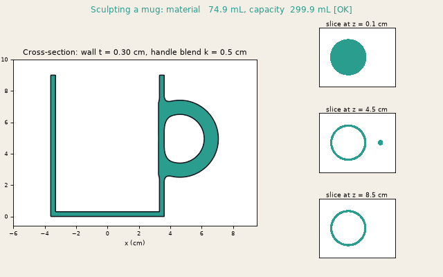
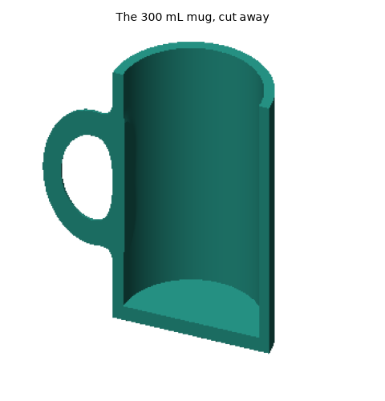
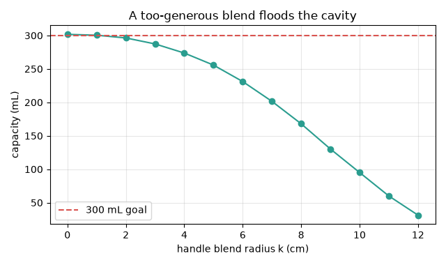
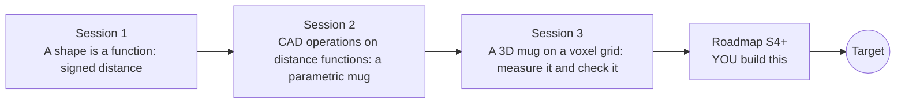

# opensculpt

[](https://github.com/KrunalPanchal1995/opensculpt/actions/workflows/ci.yml)   [](https://colab.research.google.com/github/KrunalPanchal1995/opensculpt/blob/main/sessions/session-01/lesson.ipynb) [](https://krunalpanchal1995.github.io/opensculpt/)

**Model a mug and other CAD parts as distance functions, in three sessions.**

opensculpt teaches how a CAD kernel can describe a part as a signed distance function, then builds a parametric mug that must hold 300 mL, using only Python and a browser.

- **A part is a function.** Session 1 needs only school geometry: distance from a point to a circle or a box.
- **Change a number, change the part.** Every session ships a slider app: resize the wall, the radius or the blend and watch the part and its volume.
- **Know you got it right.** Volumes, areas, contour lengths and gradients are checked against exact formulas; each checkpoint prints PASS or FAIL.
- **Build the missing half.** The repo stops at Session 3; the roadmap shows the path to meshes, assemblies and optimisation.

[Target](#the-target) · [Who is this for](#who-is-this-for) · [Quick start](#quick-start) · [Sessions](#sessions) · [Roadmap](#roadmap) · [Contribute](#contribute) · [Explainer PDF](docs/explainer.pdf)

> **This repo is incomplete on purpose.** Sessions 1 to 3 are here and fully working. The finished Target below is a preview of what the community can build next. We show you the path, not the code. Sessions 4 and up are yours.

## The Target

A mug is sculpted by two sliders. First the wall thickness sweeps from 0.3 to 0.8 cm while the radius is re-solved so the cup keeps holding 300 mL; the cross-section, three horizontal slices and a live volume readout update together. Then the handle blend radius grows until the smooth union floods the cavity and the readout turns red. Your goal over the coming sessions: build the sliders-to-volume loop yourself, then take it to meshes and assemblies.



*Target: a mug sculpted by wall thickness and handle blend sliders, with cross-section, slices and a live volume readout*



*Target: the 300 mL mug as a cut-away ray-marched render*



*Target: capacity against handle blend radius, the cavity floods*

Try it live:

- [Math Visual Studio (Studio root)](https://krunalpanchal1995.github.io/studio/)

How the Target was made is shown only as a path in [promo/roadmap.md](promo/roadmap.md).

## Who is this for
**diploma / undergraduate to advanced undergraduate (levels 5-6).** Topic area: Mechanical Engineering.

Prerequisites:

- Distance between two points and the area and volume of a circle, a box and a cylinder (school geometry).
- Python 3.10 or newer; if `python --version` works, you are ready. PRIMER.md explains the rest.
- No prior CAD, GitHub or graphics experience is needed.

New to Python? Read [PRIMER.md](PRIMER.md) first (10 minutes).

## Quick start

No installation knowledge needed. You need [Git](https://git-scm.com/downloads) and [Python 3.10+](https://www.python.org/downloads/) (Windows: tick "Add Python to PATH"). On Mac and Linux type `python3` wherever this page says `python`.

```bash
git clone https://github.com/KrunalPanchal1995/opensculpt.git
cd opensculpt
python start.py 1
```

`start.py` creates a private environment, installs what is needed and runs Session 1 with its checkpoint. Next: `python start.py 2`, `python start.py 3`, or `python start.py test` to check everything. Only a checkpoint: `python start.py check 1`.

Four lines turn the idea of Session 1 into a result (they work as they are): Save it as `try.py` and run it with `python start.py run try.py` (this uses the private environment, where NumPy is installed):

```python
import numpy as np
p = np.array([3.0, 4.0])                          # a point in the plane
d = np.linalg.norm(p - np.array([0.0, 0.0])) - 2.0   # circle of radius 2 at the origin
print(d)                                         # -> 3.0 : the point is 3 units outside the circle
```

Every session also opens in your browser with sliders (no install): [live apps](https://krunalpanchal1995.github.io/opensculpt/). Or use the Colab badge above for the notebook.

## Sessions

| # | Session | Model level | Time | Live app |
|---|---|---|---|---|
| 1 | [A shape is a function: signed distance](sessions/session-01/README.md) | Level 1: conceptual interactive model | 60 min | [open](https://krunalpanchal1995.github.io/opensculpt/session-01/) |
| 2 | [CAD operations on distance functions: a parametric mug](sessions/session-02/README.md) | Level 2: mathematical engineering model | 75 min | [open](https://krunalpanchal1995.github.io/opensculpt/session-02/) |
| 3 | [A 3D mug on a voxel grid: measure it and check it](sessions/session-03/README.md) | Level 3: simulation and validation | 90 min | [open](https://krunalpanchal1995.github.io/opensculpt/session-03/) |

Each session follows the same six steps: A real-world problem, B concept and theory, C visual explanation, D interactive simulation, E worked example and experiment, F assessment and design challenge. Each ends with `checkpoint.py`, which prints `PASS` or `FAIL` against reference numbers. Session 3 also contains the real-world mini-project: **Design a mug that holds 300 mL and weighs under 320 g**.

## Architecture



| Folder or file | What is inside |
|---|---|
| `sessions/` | three sessions: README (A-F), `lesson.py`, notebook, live app, exercises, activity sheet, checkpoint |
| `promo/` | the Target: media, live links, and the roadmap (path only) |
| `docs/` | `explainer.tex` and the built `explainer.pdf` |
| `tests/` | runs every lesson and checkpoint headless |
| `start.py` | one command to set up and run anything |
| `QUALITY.md`, `RUBRIC.md` | the quality checklist and the scoring rubric |
| `.github/` | CI, PDF build, Pages deploy, issue and PR templates |

## Roadmap

| Milestone | What you will build | Difficulty |
|---|---|---|
| Session 4: Marching cubes: a 3D mesh and an STL file | A function that turns the mug field into triangles and writes an STL file. | advanced |
| Session 5: Repair the field: redistancing | A routine that turns the field of two crossing half-spaces into a true distance field. | advanced |
| Session 6: Fewer samples: adaptive octree volume | A volume estimator that refines only the cells near the surface. | advanced |
| Session 7: Assembly: a lid that fits | A lid part positioned on the mug with a fixed clearance. | intermediate |
| Session 8: Sensitivity-driven design | A Newton iteration on the wall thickness that holds 300 mL. | intermediate |

Full detail with a checkpoint per milestone: [promo/roadmap.md](promo/roadmap.md).

## Contribute
New to GitHub? Read [CONTRIBUTING.md](CONTRIBUTING.md); it starts from zero. Pick an issue labelled `good first issue`. Translations into Hindi, Telugu, Tamil and Malayalam are welcome.

<details>
<summary>Development</summary>

```bash
python start.py test        # runs every lesson and checkpoint
```
Lessons use `# %%` cell markers so they open as notebooks in VS Code. See [QUALITY.md](QUALITY.md) for the standard every session meets.
</details>

## License
MIT. See [LICENSE](LICENSE). Media in `promo/media` is (c) Krunal Panchal, CC BY 4.0.

## Acknowledgments
Part of the [PAN IIT OSS](https://hellofoss.tech-iitb.org/projects) open-source teaching collection, modelled on the structure of [openspline](https://github.com/openspline/openspline). Built on ideas from the Math Visual Studio at https://krunalpanchal1995.github.io/studio/.
