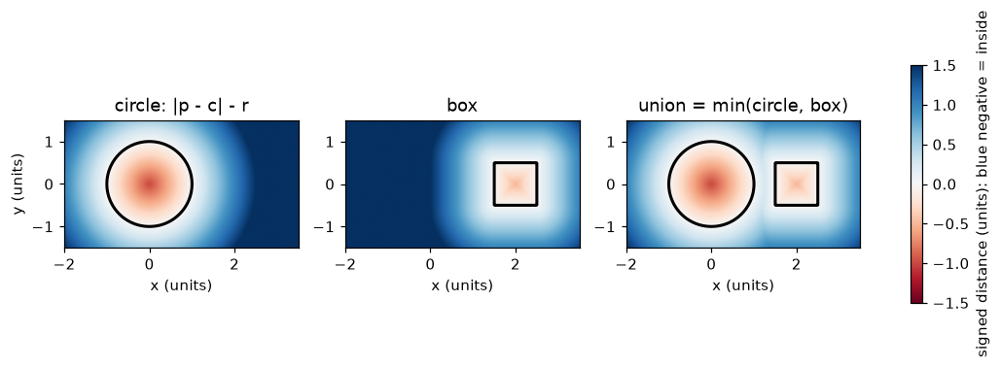
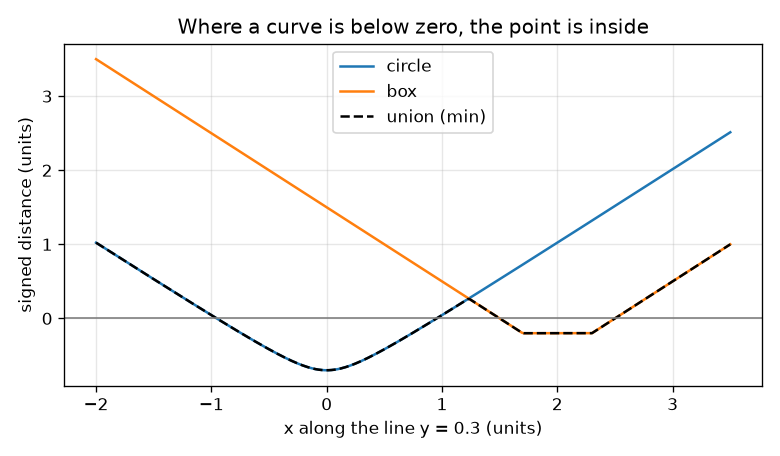

# Session 1: A shape is a function: signed distance

*Level 1 (conceptual interactive model) · about 60 minutes · opensculpt*

> This is a simplified educational model. It is not a validated design tool and must not be used for real structures, electrical installations, vehicles, industrial processes or medical decisions.

**Prerequisites**

- Distance between two points; the idea of a circle (all points at one distance from a centre).
- You have read PRIMER.md and run `python start.py 1` once.

**Learning objectives.** After this session you can:

- Explain what a signed distance is and why negative means inside.
- Compute the signed distance from a point to a circle and to a box.
- Join two shapes with min and read the result from a picture and from a graph.
- Estimate an area by counting grid cells that are inside.

## A. Real-world problem
A CAD program holds a mug and must answer, millions of times per second, one question: is this point inside the mug? Instead of storing a list of faces, we can store a function: give it any point and it returns one number, the distance to the nearest surface, with a minus sign if the point is inside. Can you describe a circle and a box that way, draw them as pictures, and use the numbers to join the shapes?

## B. Concept and theory
Take a point p = (x, y). For a circle with centre c and radius r, the signed distance is |p - c| - r: positive outside, zero on the edge, negative inside, and -r at the centre. For a box with centre c and half-sizes (a, b), first compute q = |p - c| - (a, b) separately for x and y. If both parts of q are negative the point is inside and the distance to the nearest side is the larger part of q (the one closest to zero). Otherwise the distance is the length of the vector made of the positive parts of q. The shape itself is the set of points where the value is negative; its surface is where the value is zero. A point in the union of two shapes is inside at least one of them, so the union has value min(d1, d2). A true signed distance cannot change faster than you move: a step of length s changes it by at most s.

| Symbol | Meaning | Unit |
|---|---|---|
| p = (x, y) | a point in the plane | units (any length unit) |
| c | centre of a circle or box | units |
| r | radius of the circle | units |
| (a, b) | half-width and half-height of the box | units |
| d | signed distance (negative inside) | units |

**Assumptions**

- Everything is flat (2D) in this session.
- Shapes are solid: the inside is part of the shape.
- Grid cells are judged by the value at their centre.

$$ d_{\text{circle}}(\mathbf p)=|\mathbf p-\mathbf c|-r $$

$$ \mathbf q=\big(|x-c_x|-a,\ |y-c_y|-b\big),\qquad d_{\text{box}}(\mathbf p)=\big|\max(\mathbf q,\mathbf 0)\big|+\min\big(\max(q_x,q_y),0\big) $$

$$ d_{\text{union}}=\min(d_1,\ d_2) $$

## C. Visual explanation
The first figure draws three fields in colour: the circle, the box and their union. Blue means negative (inside), red means positive (outside), and the black line is the surface where the value is zero. The second figure follows the horizontal line y = 0.3 through both shapes: the circle curve dips below zero for x between -0.954 and 0.954, the box curve for x between 1.5 and 2.5, and the black union curve is the lower of the two, so the union is inside on both stretches.

*Circle, box and union as colour fields; the black line is the surface (value 0).*

*Values along the line y = 0.3; the union is the lower curve and is inside where it is below zero.*

## D. Interactive simulation
Run the lesson (`python start.py 1`), then open the live app: [Session 1: a shape is a function](https://krunalpanchal1995.github.io/opensculpt/session-01/) (or `app.html` in this folder). Move the query point and the radius. In the picture watch the colour at the red point and the dashed circle whose radius equals the absolute value; in the graph view see the black union curve follow the lower of the circle and box curves.

**Challenge.** Put the query point inside the union, so the readout says INSIDE.

## E. Worked example and experiment
**Problem.** A circle has radius 1 and centre (0, 0). A box has centre (2, 0) and half-sizes (0.5, 0.5). Find the signed distance of the point (1.2, 0.3) to each shape and to their union.

1. Circle: |p - c| = sqrt(1.2^2 + 0.3^2) = sqrt(1.53) = 1.237, so d = 1.237 - 1 = 0.237.
2. Box: q = (|1.2 - 2| - 0.5, |0.3 - 0| - 0.5) = (0.3, -0.2).
3. The positive parts of q are (0.3, 0), of length 0.3, and max(qx, qy) = 0.3 is not negative, so the inside term is 0 and d = 0.3.
4. Union = min(0.237, 0.300) = 0.237. The value is positive, so the point is outside both shapes, closest to the circle.

**Answer.** Circle 0.237, box 0.300, union 0.237 (all in the same unit as the coordinates): the point is outside.

**Experiment.** Draw the circle and the box on squared paper, mark the point (1.2, 0.3) and measure with a ruler its shortest distance to the circle edge (about 0.24) and to the box edge (about 0.3). Compare with checkpoint.py. Small differences are the ruler and the pencil width: the formula is exact, the drawing is not.

## F. Assessment and design challenge
**Question type A: Conceptual.** Why do we use a negative value for points inside a shape, rather than just the distance to the surface?

Hint

What would a point at the centre of a circle and a point far away both look like if we only used the size of the distance?

Step-by-step solution

A distance with no sign cannot tell inside from outside: a point 1 unit inside and a point 1 unit outside would both read 1. The sign makes the surface exactly the places where the value is zero, and lets us decide inside or outside by checking the sign. It also makes the union simple: take the smaller number.

**Question type B: Numerical.** A circle of radius 2 is centred at the origin. What is the signed distance of the point (3, 4)? Is it inside?

Hint

Distance from the origin to (3, 4) first, then subtract the radius.

Step-by-step solution

|p - c| = sqrt(3^2 + 4^2) = 5, so d = 5 - 2 = 3 units. Positive, so the point is outside. Sanity check: the nearest point of the circle is 2 units from the centre along the same line, leaving 3 units.

**Question type C: Graph and simulation interpretation.** In the profile graph along the line y = 0.3, between which x values is the union inside? Why are there two separate stretches?

Hint

Find where the black curve is below the zero line.

Step-by-step solution

The union is inside for x between -0.954 and 0.954 (circle) and for x between 1.5 and 2.5 (box). Between 0.954 and 1.5 both shape curves are above zero, so the line passes through empty space between the two shapes.

**Question type D: Design and optimisation challenge.** Design: the box has centre (2, 0) and half-sizes (0.5, 0.5). Choose the radius of a circle centred at the origin so that the two shapes just touch, then so that they overlap. Which is better for a real part and why?

Hint

The left side of the box is the line x = 1.5. Where does the circle reach along the x axis?

Step-by-step solution

The circle reaches x = r on the x axis, so r = 1.5 makes the two just touch at (1.5, 0): both values are 0 there. With r = 1.6 the point (1.5, 0) has value -0.1 in the circle, so the shapes overlap by 0.1 units. A real part should overlap: with only a touching point the joint has zero thickness and cannot carry load, and round-off could separate the shapes. The trade-off is a slightly bigger part.

Score yourself with [RUBRIC.md](../../RUBRIC.md). Print the [activity sheet](activity_sheet.md) to work on paper.

## Common misconceptions
| Common misconception | What is actually true |
|---|---|
| The value of the field is the same as the distance to the centre. | It is the distance to the nearest point of the surface (the circle formula subtracts the radius for exactly that reason). |
| A shape is the places where the value is 0. | The value is 0 only on the surface; the shape is where the value is negative (and the surface is its boundary). |
| The union of two shapes is the sum of their numbers. | The union is the smaller of the two numbers: inside either shape is inside the union. |
| More cells in the grid always gives exactly the true area. | Counting is an estimate; it gets better as cells get smaller, and very thin features can still be missed. |

## Glossary
- **signed distance**: distance to the nearest surface, negative inside, zero on the surface, positive outside
- **surface**: the places where the value is zero
- **grid cell**: a small square of the plane; judged inside or outside by the value at its centre
- **union**: the shape that is inside at least one of two shapes; its value is the minimum

## Finish
1. Do the three coding tasks in [exercises.md](exercises.md).
2. Run `python start.py 1` again after your changes. It ends with the checkpoint; when it prints `PASS`, you are done. (Checkpoint only: `python start.py check 1`.)

Next: [Session 2](../session-02/README.md)
