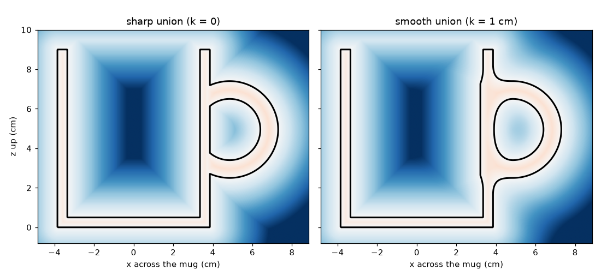
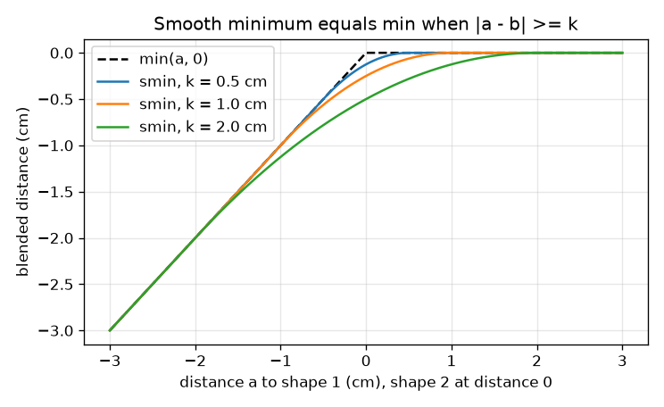

# Session 2: CAD operations on distance functions: a parametric mug

*Level 2 (mathematical engineering model) · about 75 minutes · opensculpt*

> This is a simplified educational model. It is not a validated design tool and must not be used for real structures, electrical installations, vehicles, industrial processes or medical decisions.

**Prerequisites**

- Session 1: signed distance of a circle and a box, union as min.
- Area of a circle and the volume of a cylinder.

**Learning objectives.** After this session you can:

- Build intersection, subtraction, offset, shell and smooth union from signed distances.
- Use the smooth minimum and verify that it equals min when the shapes are far apart.
- Build a parametric mug cross-section and count its area on a grid.
- Solve a design problem: choose the radius for 300 mL from the volume of revolution.

## A. Real-world problem
A designer needs a mug that holds 300 mL. The height is fixed at 9 cm by the shelf; the wall thickness and the radius are free. How do we build the mug from simple shapes, let a program change its size, and compute its volume and capacity? Lengths are in cm, so 1 cm^3 = 1 mL.

## B. Concept and theory
With signed distances a and b: intersection is max(a, b) (inside both), subtraction a minus b is max(a, -b) (inside a and not inside b), an offset that grows a shape by t is a - t, and a shell of thickness t on each side of the surface is |a| - t. Plain min leaves a sharp crease where two shapes meet; a smooth minimum rounds it. With blend radius k we use h = max(k - |a - b|, 0) / k and smin = min(a, b) - h^2 k / 4. When |a - b| >= k, h = 0 and smin equals min exactly; when a = b the surface is pulled outward by the largest amount, k / 4. The mug cross-section lives in the plane (x, z): the outer wall is a box of half-width R from z = 0 to z = H, the cavity is a box of half-width R - t that starts at the floor z = t and rises above the rim, and the handle is a ring |circle| - tube radius, clipped to stay outside the cavity and blended to the body. Because the body is a solid of revolution about the axis, its capacity is pi (R - t)^2 (H - t) and its material is pi R^2 H minus the capacity; solving for the radius gives R = t + sqrt(V / (pi (H - t))).

| Symbol | Meaning | Unit |
|---|---|---|
| R | outer radius of the mug | cm |
| H | height of the mug | cm |
| t | wall and floor thickness | cm |
| k | blend radius of the smooth union | cm |
| V | capacity (volume the mug holds) | mL = cm^3 |
| a, b | signed distances of two shapes | cm |

**Assumptions**

- The wall and the floor have the same thickness t.
- The cavity is open at the top.
- The handle ring has centre-line radius 2 cm and tube radius 0.45 cm and is not part of the capacity.
- Capacity is the brim-full volume and ignores the shape of the rim.

$$ d_{\cap}=\max(a,b),\qquad d_{A\setminus B}=\max(a,-b),\qquad d_{\text{shell}}=|a|-t $$

$$ h=\frac{\max(k-|a-b|,\,0)}{k},\qquad \mathrm{smin}(a,b)=\min(a,b)-\frac{k\,h^{2}}{4} $$

$$ V_{\text{cavity}}=\pi\,(R-t)^{2}(H-t),\qquad V_{\text{material}}=\pi R^{2}H-V_{\text{cavity}} $$

$$ R=t+\sqrt{\dfrac{V}{\pi\,(H-t)}} $$

## C. Visual explanation
The first figure shows the mug cross-section as a colour field with the zero line in black, for a sharp union (k = 0) and a smooth union (k = 1 cm): the smooth one adds material in the crotch where the handle meets the wall. The second figure plots the smooth minimum against the distance a to one shape while the other shape is at distance 0: it follows min(a, 0) exactly away from the crossing and rounds the corner within k, lying below min by at most k / 4.

*The mug cross-section from signed distances: sharp union (left) and smooth union with blend 1 cm (right).*

*The smooth minimum equals min away from the crossing and is below it by at most k / 4.*

## D. Interactive simulation
Run the lesson (`python start.py 2`), then open the live app: [Session 2: a parametric mug](https://krunalpanchal1995.github.io/opensculpt/session-02/) (or `app.html` in this folder). Change the radius, wall, height and blend. In the section view watch the mug and handle change; in the graph view see the capacity curve against R and where it crosses the red 300 mL line.

**Challenge.** Hold 300 mL (within 10 mL) with a wall of at least 0.4 cm and a mug no taller than 9 cm.

## E. Worked example and experiment
**Problem.** Find the outer radius of a mug of height 9 cm and wall 0.5 cm that holds exactly 300 mL, and the volume of material in the body.

1. Capacity = pi (R - t)^2 (H - t), with H - t = 9 - 0.5 = 8.5 cm.
2. (R - t)^2 = 300 / (pi * 8.5) = 11.23, so R - t = 3.352 cm.
3. R = 0.5 + 3.352 = 3.852 cm.
4. Material = pi R^2 H - 300 = pi * 3.852^2 * 9 - 300 = 419.5 - 300 = 119.5 cm^3.

**Answer.** R = 3.852 cm; the body holds 300 mL and contains 119.5 cm^3 of material.

**Experiment.** Measure a real straight-sided mug: inner diameter, inner depth. Compute pi (d / 2)^2 * depth, then fill it with water from a measuring jug up to the rim and compare. Expect a few percent difference: real mugs have a rounded inside corner, a tapered wall and a rim you do not fill to, which the model leaves out.

## F. Assessment and design challenge
**Question type A: Conceptual.** Why does the smooth union add material only near the place where the two shapes come close, and not everywhere?

Hint

Look at what happens to the formula when |a - b| is larger than k.

Step-by-step solution

When |a - b| >= k we get h = 0, so smin = min(a, b) exactly: far from the junction nothing changes. Only where the two distances are within k of each other does h become positive and the surface is pulled outward, by at most k / 4 where they are equal.

**Question type B: Numerical.** Find the outer radius for a mug of height 10 cm and wall 0.4 cm that holds 300 mL.

Hint

R = t + sqrt(V / (pi (H - t))).

Step-by-step solution

H - t = 9.6 cm; 300 / (pi * 9.6) = 9.947; sqrt = 3.154 cm; R = 0.4 + 3.154 = 3.554 cm. Sanity check: a taller, thinner mug needs a smaller radius than the 3.852 cm of the worked example, as found.

**Question type C: Graph and simulation interpretation.** In the smooth-min graph with blend radius k = 2 cm, how far below min(a, b) is the blended value at a = b?

Hint

Use k / 4.

Step-by-step solution

k / 4 = 0.5 cm: for a = b = 0 the smooth minimum is -0.5 cm. Away from the crossing, further than k = 2 cm from it, the curves coincide.

**Question type D: Design and optimisation challenge.** Design: for H = 9 cm and 300 mL, compare walls of 0.4 cm and 0.8 cm. Give the radius and the volume of material for each, and say which you would choose for a mug that is dropped often, and why.

Hint

Use the formula for R, then material = pi R^2 H - 300.

Step-by-step solution

For t = 0.4 cm: R = 3.732 cm and material 93.9 cm^3. For t = 0.8 cm: R = 4.213 cm and material 201.7 cm^3. The thick wall uses more than twice the material (so it is heavier and more expensive) and makes a wider mug, but it is far more robust; the model cannot say how much stronger, so a designer would test samples. A middle value such as 0.5 cm needs 119.5 cm^3.

Score yourself with [RUBRIC.md](../../RUBRIC.md). Print the [activity sheet](activity_sheet.md) to work on paper.

## Common misconceptions
| Common misconception | What is actually true |
|---|---|
| Subtraction a minus b is min(a, -b). | Subtraction keeps points in a that are not in b: max(a, -b). Min is the union. |
| A smooth union always changes the whole part. | It equals the plain minimum except where the two distances differ by less than k. |
| Counting grid cells gives an exact area. | It is an estimate: with a thin wall and a coarse grid the answer can be off by tens of percent, and it improves as the cells shrink. |
| Doubling the wall thickness doubles the material. | Material grows faster than that for a fixed capacity, because the radius also has to grow. |

## Glossary
- **intersection**: the shape inside both of two shapes; its value is max(a, b)
- **subtraction**: cutting one shape out of another: max(a, -b)
- **offset**: growing (positive t) or shrinking a shape by subtracting t from its value
- **shell**: a skin of thickness t on each side of a surface: |a| - t
- **smooth minimum**: a rounded version of min controlled by a blend radius k
- **volume of revolution**: the volume of a solid made by spinning a flat shape about an axis

## Finish
1. Do the three coding tasks in [exercises.md](exercises.md).
2. Run `python start.py 2` again after your changes. It ends with the checkpoint; when it prints `PASS`, you are done. (Checkpoint only: `python start.py check 2`.)

Next: [Session 3](../session-03/README.md)
