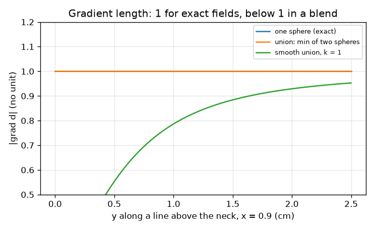
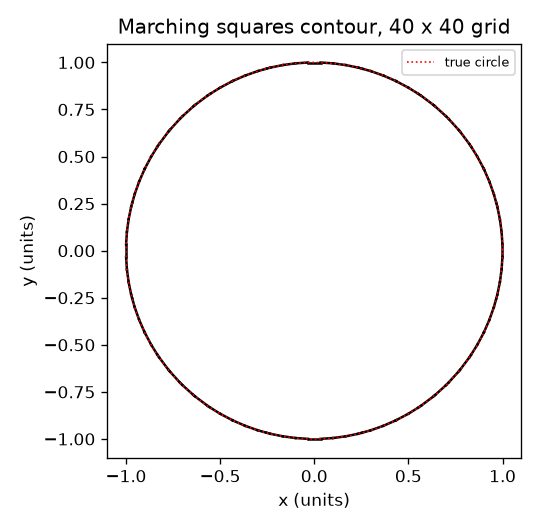
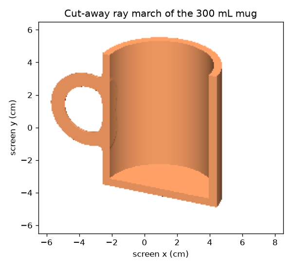
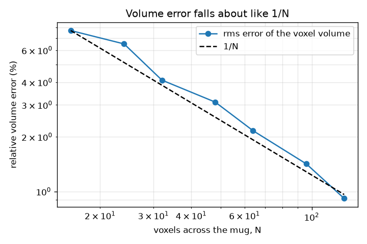

# Session 3: A 3D mug on a voxel grid: measure it and check it

*Level 3 (simulation and validation) · about 90 minutes · opensculpt*

> This is a simplified educational model. It is not a validated design tool and must not be used for real structures, electrical installations, vehicles, industrial processes or medical decisions.

**Prerequisites**

- Session 1: signed distance.
- Session 2: CAD operations, smooth union and the volume of revolution formulas.

**Learning objectives.** After this session you can:

- Sample a 3D signed distance function on a voxel grid and estimate volume by counting.
- Measure how the volume error falls as the grid is refined, and fit its rate.
- Extract a contour with marching squares and check its length converges to 2 pi r.
- Use the gradient for the surface normal, check the Eikonal property, and render a cut-away.
- Check d(volume)/d(thickness) against the surface area, and find two failure modes.

## A. Real-world problem
A manufacturer wants a mug that holds 300 mL and weighs under a limit. We have a function for the mug; we do not have formulas for the handle's overlap with the wall. So we measure: fill a box with small cubes (voxels), count the ones inside and multiply by the volume of one cube. How accurate is that, how does it improve with finer cubes, what does it get wrong, and can we trust it to decide a design? Lengths are in cm, volumes in cm^3 = mL, density in g/cm^3.

## B. Concept and theory
The 3D mug is built as in Session 2 but with a finite cylinder for the outer wall, a smaller cylinder for the cavity (subtracted), and a torus for the handle, clipped to stay outside the cavity and joined by a smooth union of blend radius k. For voxels of side h, the volume estimate is V = (number of voxels with value < 0) h^3, which equals the fraction of inside voxels times the box volume. The error comes from the voxels the surface cuts, which number about (surface area) / h^2, each wrong by up to h^3, so the error is of order (surface area) h: it falls like 1 / N when N voxels span the part. For a contour we use marching squares: in each square of four corners the contour crosses the edges where the sign changes, placed by linear interpolation, and the segments are joined; total length approximates the curve length with an error that falls like 1 / N^2 for a smooth curve. The gradient by central differences, (d(x + e) - d(x - e)) / (2 e), has length 1 for an exact distance field and points along the outward normal. Taking min or max of exact fields keeps the length at 1 but values near sharp corners are not exact distances (for max, the value is too small); a smooth union has a gradient shorter than 1 in the blend. Sensitivity: thickening a wall by dt adds a layer of volume (surface area) dt, so d(volume)/dt equals the area of the surface that moves; for the mug, the cavity wall plus floor, 2 pi (R - t)(H - t) + pi (R - t)^2.

| Symbol | Meaning | Unit |
|---|---|---|
| h | voxel side | cm |
| N | number of voxels across the mug diameter plus margins | no unit |
| V | volume estimate | cm^3 = mL |
| rho | density of the material | g/cm^3 |
| k | blend radius | cm |
| A | surface area that moves when the wall thickens | cm^2 |
| grad d | gradient of the signed distance | no unit |

**Assumptions**

- The mug is brim-full measured; capacity is the empty volume inside the cavity cylinder.
- The wall and the floor have the same thickness t.
- Material is uniform with density 2.4 g/cm^3 (a typical ceramic: check your own material).
- This is a teaching model, not a validated design tool for strength or safety.

$$ V\approx h^{3}\,\#\{\text{voxels with } d<0\} $$

$$ \text{error}\propto A\,h\ \sim\ \frac{1}{N} $$

$$ \nabla d\approx\left(\frac{d(\mathbf x+\epsilon\mathbf e_i)-d(\mathbf x-\epsilon\mathbf e_i)}{2\epsilon}\right)_{i=x,y,z},\qquad |\nabla d|=1\ \text{(exact field)} $$

$$ \frac{dV_{\text{body}}}{dt}=2\pi(R-t)(H-t)+\pi(R-t)^{2} $$

$$ m=\rho\,V $$

## C. Visual explanation
Four figures. The volume-error figure plots the relative error of the voxel volume against N on log-log axes together with a dashed 1/N line; they run parallel. The marching-squares figure shows the contour of a circle on a 40 by 40 grid on top of the true circle. The gradient figure plots the length of the gradient along a line above the neck of two spheres: 1 for an exact sphere and for the plain union, and a dip for the smooth union. The render is a cut-away of the 300 mL mug obtained by marching rays through the field and shading with the gradient as the normal.

*Gradient length: 1 for exact fields, below 1 inside a smooth blend.*

*Marching squares on a 40 by 40 grid: the contour (black) against the true circle (red dots).*

*Cut-away ray march of the 300 mL mug, shaded with the gradient normal.*

*RMS error of the voxel volume against N (log-log) with a dashed 1/N line.*

## D. Interactive simulation
Run the lesson (`python start.py 3`), then open the live app: [Session 3: voxels, wall and blend](https://krunalpanchal1995.github.io/opensculpt/session-03/) (or `app.html` in this folder). Change the voxel size, wall thickness and blend radius. In the slice view see how the blue voxels follow the exact grey outline, how the wall breaks when it is thinner than about two voxels, and how a large blend fills the cavity; in the graph view read the volume error against voxel size.

**Challenge.** Resolve the wall with at least 3 voxels across its thickness (t / h at least 3) while using a blend radius of at least 2 cm.

## E. Worked example and experiment
**Problem.** For the 300 mL mug (R = 3.852 cm, H = 9 cm, t = 0.5 cm), find the exact volume of the body and of the torus handle, and the mass of the whole mug in a ceramic of density 2.4 g/cm^3.

1. Body volume = pi R^2 H - pi (R - t)^2 (H - t) = 419.5 - 300.0 = 119.49 cm^3.
2. Torus volume = 2 pi^2 Rh r^2 = 2 pi^2 * 2.0 * 0.45^2 = 7.99 cm^3 (full ring; part of it overlaps the wall and the cut-off inner half is removed, so the added volume is smaller).
3. Body mass = 2.4 * 119.49 = 286.8 g.
4. For the handle and its overlap we use the voxel volume of the whole mug (blend radius 0.5 cm): mass of about 301 g.
5. Check: the handle adds about 14 g, which is below the 7.99 cm^3 * 2.4 = 19 g of a full torus, as expected since part of the ring is cut away or merges with the wall.

**Answer.** Body 119.49 cm^3 (286.8 g); the whole mug weighs about 301 g with the handle, and the exact torus volume is 7.99 cm^3.

**Experiment.** Weigh a real ceramic mug on a kitchen scale and fill it with water to the brim from a measuring jug, then compare with the model. Typical differences are a rounded interior, a glaze layer, a foot ring under the base and a different density (porous ceramics are lighter): the model has none of these, so expect differences of 10 percent or more.

## Real-world application and mini-project: Design a mug that holds 300 mL and weighs under 320 g
A ceramics workshop wants a mug of height 9 cm with a handle (ring of radius 2 cm, tube radius 0.45 cm, blend radius 0.5 cm). It must hold 300 mL and weigh less than 320 g in a ceramic of density 2.4 g/cm^3. Thick walls are stronger, so the workshop wants the thickest wall in steps of 0.05 cm that still meets the mass limit. For each wall t from 0.30 to 0.80 cm, solve the outer radius for 300 mL with the Session 2 formula, build the mug with `mug3d` from Session 3, and estimate its mass from the voxel volume with `mug_mass`.

**Deliverable:** A script that prints, for each t, the radius, the voxel mass and PASS or FAIL against 320 g, names the thickest passing wall, and saves a picture of the cut-away mug for that wall.

**Success looks like:** The thickest passing wall is 0.50 cm (R = 3.852 cm, mass about 301 g); 0.55 cm fails (about 336 g). Check the capacity of your final mug with `cavity_capacity`: it must be 300 mL to within 1 percent.

## F. Assessment and design challenge
**Question type A: Conceptual.** Why does the volume error of a voxel count depend on the surface area, and why does it fall about like 1 / N?

Hint

Which voxels can be wrong, and by how much?

Step-by-step solution

Voxels fully inside or fully outside are always judged correctly. Only voxels cut by the surface can be wrong, and each is wrong by at most one voxel volume h^3. There are about (surface area) / h^2 such voxels, so the error is of order (surface area) * h. Since h is proportional to 1 / N, the error falls like 1 / N. In our measurement the log-log slope is about -1.

**Question type B: Numerical.** The cavity wall and floor have area 2 pi (R - t)(H - t) + pi (R - t)^2. Compute it for R = 3.852, t = 0.5, H = 9 cm and use it to estimate the change in body volume when the wall grows from 0.5 to 0.6 cm (R and H fixed).

Hint

Multiply the area by the change in thickness; compare with the exact change.

Step-by-step solution

Area = 2 pi * 3.352 * 8.5 + pi * 3.352^2 = 179.0 + 35.3 = 214.3 cm^2. Estimated change = 214.3 * 0.1 = 21.4 cm^3. The exact change is 20.96 cm^3, a little smaller, because the cavity area itself shrinks as the wall grows; the estimate is first order in the step. Units: cm^2 times cm gives cm^3.

**Question type C: Graph and simulation interpretation.** From the blend-radius results: the empty cavity is 300 mL with no blend, about 294 mL with k = 2 cm, about 166 mL with k = 8 cm and 0 with k = 16 cm. Explain what happens physically and what blend radius you would allow.

Hint

Where is the field of the handle within k of the field of the body?

Step-by-step solution

A smooth union adds material wherever the distances to the two shapes differ by less than k, pulling the surface out by up to k / 4. With a large k the region stretches across the whole cavity, which is far from the handle by only a few cm, so the cavity fills. A mug that must hold 300 mL cannot afford a large blend: k = 2 cm already costs about 2 percent of the capacity, so keep k small (the mini-project uses 0.5 cm).

**Question type D: Design and optimisation challenge.** Design: choose the thickest wall in steps of 0.05 cm from 0.30 to 0.80 for a 300 mL mug of height 9 cm that must weigh less than 320 g (ceramic 2.4 g/cm^3, blend 0.5 cm). Justify with the numbers and state what the model leaves out.

Hint

Solve R for each t and use mug_mass; mass grows with t at fixed capacity.

Step-by-step solution

t = 0.50 cm (R = 3.852 cm) weighs about 301 g and passes; t = 0.55 cm (R = 3.912 cm) weighs about 336 g and fails. So the thickest passing wall is 0.50 cm. Left out: strength (a thick wall is stronger but the model cannot say how much), thermal behaviour, a rounded rim, tolerances in the voxel estimate (about 1 percent), and the fact that the 320 g limit would be tested on real pieces.

Score yourself with [RUBRIC.md](../../RUBRIC.md). Print the [activity sheet](activity_sheet.md) to work on paper.

## Common misconceptions
| Common misconception | What is actually true |
|---|---|
| A finer grid always gives a smaller error at every step. | On average yes (like 1 / N), but a single estimate can get worse by chance as the grid shifts relative to the part. Measure over several shifts. |
| The gradient of any combined field has length 1, so the field is a true distance. | min and max keep a gradient of length 1 but the values near sharp corners are not exact distances (max at (1, 1) says 1, the true distance to the corner is sqrt(2)), and smooth blends have a gradient below 1. |
| A thin wall is just a little less accurate. | A wall thinner than a voxel can disappear entirely: a sample line sees a 0.3 cm wall only 60 percent of the time with 0.5 cm voxels. |
| Smoothing the handle joint is free. | A blend radius adds material across a region and can steal capacity from the cavity; the larger it is the worse it gets. |

## Glossary
- **voxel**: a small cube of the 3D grid, the 3D version of a pixel
- **marching squares**: an algorithm that traces the zero contour of a field from a 2D grid
- **Eikonal property**: the gradient of an exact distance field has length 1
- **ray march**: finding where a ray hits a surface by stepping along it by the field value
- **surface normal**: a vector of length 1 pointing straight out of the surface; the normalised gradient
- **sensitivity**: how much an output (volume) changes when an input (thickness) changes

## Finish
1. Do the three coding tasks in [exercises.md](exercises.md).
2. Run `python start.py 3` again after your changes. It ends with the checkpoint; when it prints `PASS`, you are done. (Checkpoint only: `python start.py check 3`.)

Next: the [roadmap](../../promo/roadmap.md). Session 4 is yours to build.
